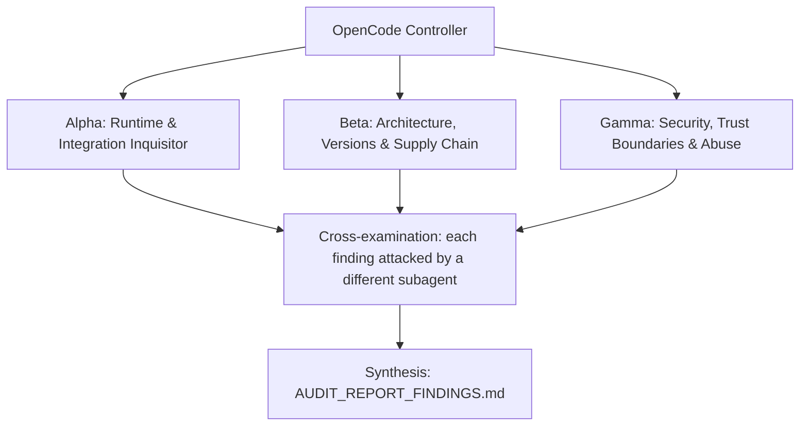

# ADVERSARIAL THREE-SUBAGENT AUDIT PROMPT: `opencode-harness`

**Target Codebase**: the Git repository this file sits in. Resolve it with `git rev-parse --show-toplevel` and treat every path below as relative to that root. Nothing in this prompt depends on where the checkout lives.
**GitHub Remote**: `https://github.com/Heretek-AI/opencode-harness`
**What it is supposed to be**: a single-session, in-process OpenCode v2 plugin (`@heretek-ai/opencode-harness`, published on npm) that gives every worker session hash-anchored edits, AST codemods, post-edit diagnostics, permission and taint guards, a doom-loop circuit breaker, KV-cache-safe context budgeting and DOM geometry auditing, by hooking the real OpenCode v2 plugin API. Blueprint refusal boundary: never an HTTP server, WebUI, worktree manager or multi-agent scheduler. Budget: 3,000 to 5,000 LOC.
**Execution Context**: OpenCode v2 autonomous audit (works the same in any agent CLI that has subagents and a shell)
**Auditor Formation**: three independent adversarial subagents (Alpha, Beta, Gamma), a cross-examination pass, and a synthesis pass
**Output**: `AUDIT_REPORT_FINDINGS.md` at the repository root

This prompt is designed to be re-run. Each run audits the current `HEAD`, re-verifies every finding of the previous run, and overwrites `AUDIT_REPORT_FINDINGS.md`.

---

## 0. Preflight (the controller does this before spawning subagents)

1. **Baseline.** Record at the top of the report: `git rev-parse HEAD`, `git log -1 --format='%ci %s'`, the UTC date, and the versions of every tool you will use (`bun`, `node`, `npm`, `git`, `rg`, `jq`, and the `anomalyco/opencode` commit you test against). If `git status --porcelain` shows changes other than this prompt file and a previous report, list the dirty files and audit a clean `git worktree` of `HEAD` instead of the working tree.
2. **Scratch space.** `export AUDIT_TMP="$(mktemp -d -t opencode-harness-audit-XXXXXX)"`. Every clone, downloaded binary, packed tarball, sabotage copy, container volume and raw log goes under `$AUDIT_TMP`. Each subagent writes its raw notes to `$AUDIT_TMP/{alpha,beta,gamma}.md`.
3. **Disposable copy for experiments.** `git worktree add --detach "$AUDIT_TMP/wt" HEAD`. Sabotage, patched configs, and any file edits happen only there. The real checkout must end the audit with `git status --porcelain` showing nothing new but `AUDIT_REPORT_FINDINGS.md` (and this prompt file, if you copied it in untracked). Remove the copy with `git worktree remove --force "$AUDIT_TMP/wt"` at the end.
4. **Previous run.** If `AUDIT_REPORT_FINDINGS.md` already exists, read it before anything else. Every finding in it gets a row in the Regression Ledger (section 6), re-verified from scratch: never copy a previous verdict forward.
5. **Network and host capabilities.** You need outbound HTTPS to github.com, raw.githubusercontent.com, registry.npmjs.org, and api.github.com. Probe what this host can do (`bun --version`, `node --version`, whether `@ast-grep/napi` loads, whether a Chromium for Playwright is present) and record it. When a check cannot run here, the claim is `UNVERIFIABLE` with the exact reason. A claim is never `VERIFIED` by inference, by reading the code alone, or because a test says so.

**Hard limits (all subagents):** no `npm publish`, no `git push`, no tags, no GitHub writes (issues, comments, PRs), no real API keys or credentials in any command, file or report (generate throwaway keys and dummy values), no destructive command outside `$AUDIT_TMP`. Read-only against the real checkout.

---

## 1. Directive & Rules of Engagement

You are a team of **three elite, adversarial principal systems auditors**. Your mandate is to stress-test, debunk, and verify every claimed feature, architectural decision, integration contract, security invariant, and version pin in **`opencode-harness`**, measured against what the repository is supposed to be (above) and what its own `README.md`, `AGENTS.md` and `docs/` claim.

### The Cardinal Rule: DO NOT BELIEVE TESTS
- Unit tests, acceptance scripts (`make accept`, `scripts/accept/wave-*.sh`) and CI badges can lie: they assert obsolete invariants, mock away the real system, or test that a file *contains* a rule rather than that the rule *works*.
- This repository has a documented history of exactly that:
  - 194 unit tests passed while the real OpenCode v2 host rejected **all 14 tools** at registration (zod 3 input schemas) and crashed on unload (`setup()` returned a non-function). The tests drove a hand-written mock host (`test/host-contract.test.ts`), not the real one. The fix added `make host-test`; that test executes only `file_hash_read`.
  - Breaking only the start-anchor check, or only the end-anchor check, in `hashEditFile` was not caught by any test.
  - npm `latest` was a broken 1.0.4 while reports described 1.0.5 and 1.0.6 as "published".
- Never conclude that a component works because `bun test` or `make accept` exits 0. Prove behavior against **the real thing it plugs into**: the real OpenCode v2 plugin host (`anomalyco/opencode`, branch `dev`, package `@opencode/plugin`), the package as installed from npm and from `npm pack`, and the upstream source files the interceptors patch around.

### The Second Rule: DO NOT BELIEVE THE PAPER TRAIL
- `docs/reports/*`, `docs/evidence/*`, "red-proof" logs, drift-guard `VERDICT: PASS` lines, `CHANGELOG.md`, and `README.md` are **claims under audit**, not evidence.
- The repo was built by agents from a self-contained prompt (`MASTER_BUILD_PROMPT.md` / `docs/prompts/SPEC.md`). That prompt contained invented facts (API names, image tags, config shapes), and the build gates only checked spec compliance. Matching the spec is not the same as working. Where the spec and reality disagree, reality wins and the spec is the defect.

### The Third Rule: SABOTAGE EVERY CRITICAL INVARIANT
- For each invariant marked **[S]** in section 3, break it with a one-line change in `$AUDIT_TMP/wt`, run the full suite there, and record whether the suite went red. Restore the line after each run.
- A sabotage the suite does not catch is a finding: **P1** ("untested invariant"), or **P0** when the invariant is a security boundary.

### Modern Version & Proper Deployment Imperative
- Every pinned version must be a **modern, supported, production-grade release that actually exists** in its registry. Flag invented versions, deprecated or archived packages, renamed organizations, floating tags (`latest`, `^` ranges on security-relevant deps, unpinned GitHub Actions), end-of-life runtimes, and versions with known CVEs (`npm audit`, OSV: `https://api.osv.dev/v1/query`).
- Verify that integration patterns follow the **official upstream documentation and source code** of the system being integrated, at the version pinned and at the current upstream head (drift is a finding).

### Verdict vocabulary
Every claim in section 3 ends with exactly one status, each backed by a command and its output:
- `VERIFIED` (proven to work against the real thing), `PARTIAL` (works with caveats you name), `BROKEN` (proven not to work), `UNVERIFIABLE` (could not be run here, with the exact reason).

---

## 2. The Adversarial Triad (Subagent Roles)



### Subagent Alpha: Runtime & Integration Inquisitor
* **Focus**: "Does the plugin actually load, register, intercept and unload inside the real OpenCode v2 host, at the pinned upstream commit and at today's `dev` head?"
* **Methodology**:
  - Run `make host-test` as shipped, then again with `OPENCODE_REF` set to the current `anomalyco/opencode` `dev` head. A pass at the pin and a failure at head is upstream drift (P1).
  - The shipped host test only executes `file_hash_read`. Extend it in `$AUDIT_TMP` (copy `scripts/host-test/harness-host.upstream.ts`) so it executes **every** direct tool and every Code Mode companion through the real host's `snapshot.execute`, and fires each hook through the host's own event shapes.
  - For every hook name and event field the harness relies on, find the definition in upstream source (`rg` in `packages/core/src`) and compare field names and types. A hook the harness registers that the host never fires is dead code that the mock-host tests make look alive.
  - Install the package the way a user would (packed tarball and the published npm version) into a fresh directory and load it from `dist/`, not `src/`.

### Subagent Beta: Architecture, Versions & Supply Chain
* **Focus**: "Is this release real, current, installable, and still the lean single-session plugin it was meant to be?"
* **Methodology**:
  - Reconcile `package.json#version`, `src/version.ts`, git tags, GitHub releases and `npm view @heretek-ai/opencode-harness dist-tags versions time`. Diff the published tarball against a fresh `bun run build`.
  - Determine whether a user can install OpenCode v2 at all (`npm view opencode-ai dist-tags`, upstream release tags vs the `dev` branch). If v2 exists only as a `dev` build, the README's install story is a finding.
  - Audit every dependency: does it exist at the pinned range, is it deprecated (`npm view <pkg> deprecated`), is it the right kind of dependency (heavy optional tooling such as `playwright` and `@axe-core/playwright` in `dependencies` inflates every install; measure with `du -sh node_modules` in a clean consumer), is `zod-to-json-schema` still maintained or superseded by zod 4's native JSON Schema output.
  - Measure scope against the blueprint: source LOC (`git ls-files src | xargs wc -l`) vs the 3,000 to 5,000 LOC budget and the original "~450-line plugin" ask; overlap with `heretek-context-router` (context budgeting, MCP seeding, role prompts).

### Subagent Gamma: Security, Trust Boundaries & Abuse
* **Focus**: "Can a model or a hostile repository use this plugin to escape its role, its workspace, or the user's consent?"
* **Methodology**:
  - Attack `src/guards/permission-guard.ts` and `src/guards/shell-parse.ts` with crafted inputs: `bash -c`, `sh -c "$(…)"`, backticks, `env X=1 rm`, `;`/`&&`/`||`/newlines, quoting tricks, `\` line continuation, absolute paths, `../` traversal, symlinks pointing out of the workspace, case and Unicode look-alikes in tool and role names, empty and unknown roles.
  - Attack `src/guards/taint-guard.ts`: list the real tool names OpenCode v2 gives MCP tools (for example `<server>_<tool>`) and check whether `isUntrustedIngestionTool` recognizes them; check whether taint survives compaction, subagents and session forks.
  - Path containment for every tool that writes (`file_hash_edit`, `ast_structural_rewrite`, `rename_symbol`, `checkpoint_rollback`, edit transactions): can any of them write outside `rootDir`?
  - Command execution surfaces: what exactly does `verify_scoped` execute, and can model-supplied arguments inject commands? What can `ui_geometry_audit` be pointed at (`file://`, internal hosts)?
  - Consent: confirm `seedRecommendedMcp` and `museCalibration` default to `false` in the real host path, and that nothing downloads or runs npm packages without opt-in.
  - CI supply chain: unpinned actions (`actions/checkout@v4`, `actions/setup-node@v4`), `npm install -g npm@latest` inside a job holding `id-token: write`, and the upstream clone + `bun install` in `make host-test`.

---

## 3. Comprehensive Inventory of Claimed Functions & Architectural Decisions

Owners: `[A]` Alpha, `[B]` Beta, `[G]` Gamma. `[S]` marks an invariant that must be sabotaged (Third Rule).

### Domain 1: Packaging & Release
* **Claim 1.1 [B]**: `package.json` version `1.0.7` equals `HARNESS_RELEASE_VERSION` in `src/version.ts`, a `v1.0.7` git tag, and the npm `latest` dist-tag.
* **Claim 1.2 [A]**: `npm pack` produces a tarball whose `exports` (`./dist/index.js`, `./dist/index.d.ts`) import cleanly under Node 22 and Bun in a fresh consumer, and whose default export is `{ id: "@heretek-ai/opencode-harness", setup }`.
* **Claim 1.3 [B]**: The tarball published on npm as `latest` matches what `main` builds (no stale or broken release is the default install).
* **Claim 1.4 [A]**: `make accept` runs waves 1 to 7; `bun run accept` (which calls `scripts/accept/run.sh`) also works.
* **Claim 1.5 [B]**: `.github/workflows/publish.yml` refuses to publish unless the tag equals the package version and `make check`, `make accept` and `make host-test` pass.

### Domain 2: OpenCode v2 Host Contract (`src/host/contract-adapter.ts`, `src/index.ts`)
* **Claim 2.1 [A][S]**: All 14 direct tools (`file_hash_read`, `file_hash_edit`, `ast_structural_search`, `ast_structural_rewrite`, `ui_geometry_audit`, `repo_map`, `blast_radius`, `file_outline`, `symbol_references`, `rename_symbol`, `verify_scoped`, `architecture_audit`, `checkpoint_create`, `checkpoint_rollback`) register in the real host because their `input` is plain JSON Schema (`toHostInputSchema`), and each executes successfully through the host.
* **Claim 2.2 [A]**: The Code Mode companions (`tools.harness.*`, `codemode: true, pinned: true`) register and are callable from `execute({ code })`.
* **Claim 2.3 [A][S]**: `setup` awaits every `hook`/`transform` registration and resolves to a cleanup function that disposes all of them; unload throws nothing, and a load/unload/load cycle leaves no duplicate hooks.
* **Claim 2.4 [A]**: Every hook surface the harness uses exists and fires in upstream with the field shapes the harness reads: `tool.transform`, `tool.hook("execute.before" | "execute.after")`, `permission.hook("evaluate")`, `session.hook("prompt" | "context" | "generate" | "compaction" | "retry" | "model.request")`, `shell.hook("create.before")`, `mcp.transform`. Check at the pinned `OPENCODE_REF` and at `dev` head.
* **Claim 2.5 [A]**: Plugin options arrive on `ctx.options` from the `plugins` entry in `opencode.json`, and `contextBudgetTokens`, `seedRecommendedMcp` (default `false`) and `museCalibration` (default `false`) take effect.
* **Claim 2.6 [B]**: The upstream facts the harness depends on still hold at `dev` head: the `meta.txt` subagent sentence it rewrites, `ToolOutput` truncation constants (`MAX_LINES = 2_000`, `MAX_BYTES = 50 KiB`), `session/runner/retry.ts`, `tool/plugin/patch.ts`, `formatter.ts`, and the `x-session-affinity` / `X-Session-Id` headers.

### Domain 3: Editing Primitives (`src/editors/`, `src/transactions/`)
* **Claim 3.1 [A][S]**: `file_hash_read` emits `<lineNo>#<4-hex FNV-1a>| <content>` with 1-based `offset`/`limit`.
* **Claim 3.2 [A][S]**: `file_hash_edit` resolves anchors across up to ±25 shifted lines and fails closed with no disk write on **any** anchor mismatch. Sabotage the start-anchor check alone and the end-anchor check alone; both must be caught.
* **Claim 3.3 [A]**: `ast_structural_search` / `ast_structural_rewrite` work with `@ast-grep/napi` and with the deterministic fallback when the native module is missing (`--ignore-scripts` installs), and rewrite writes only when a match is replaced.
* **Claim 3.4 [A][S]**: `rename_symbol` renames definitions, imports, exports and call sites atomically, ignores comments and strings, and rolls back every file when verification fails.
* **Claim 3.5 [A]**: `checkpoint_create` / `checkpoint_rollback` and edit transactions restore byte-identical content, including for files created or deleted inside the transaction.

### Domain 4: Zero-Patch Interceptors (`src/interceptors/`)
* **Claim 4.1 [A]**: `edit` input repair strips `12: ` and `12#a3f2| ` prefixes and fixes indentation drift before the real `EditTool` runs; on failure it appends a `<near-miss-anchor>` slice.
* **Claim 4.2 [A]**: `<post-edit-anchors>` receipts reflect the file **after** the upstream formatter ran.
* **Claim 4.3 [A]**: `patch` envelope repair wraps bare hunks in `*** Begin Patch` / `*** End Patch` in a form the real `Patch.parse` accepts.
* **Claim 4.4 [A]**: The cross-file import/export verifier and the contract impact analyzer report broken imports and changed exported signatures, with no false positives on this repo's own source.
* **Claim 4.5 [A][S]**: The head+tail compactor triggers above 1,400 lines or 38 KiB and keeps the tail (errors, `<diagnostics>`, `<fault-context>`) intact after upstream truncation.
* **Claim 4.6 [A][S]**: The retry hook retries transient failures (`incomplete-stream`, 502/503/504/529, `ECONNRESET`, `ETIMEDOUT`) up to attempt 3 and never retries `auth`, `invalid_api_key` or `context-overflow`.
* **Claim 4.7 [A]**: The shell hook injects `CI=1`, `GIT_TERMINAL_PROMPT=0`, `PAGER=cat`, and non-zero exits get a `<fault-context>` block.
* **Claim 4.8 [A]**: Subagent calls get a SHA-256 `<mutation-receipt>` listing every file the subagent touched.
* **Claim 4.9 [A]**: Compaction decontamination strips `[Assistant tool call]:` pseudo-transcripts and the listed contamination from real compaction requests.
* **Claim 4.10 [A]**: Root `promptCacheKey` affinity follows parent links across multiple subagent hops.

### Domain 5: Context & KV-Cache Safety (`src/context/`, `src/muse/`)
* **Claim 5.1 [A][S]**: With default options, `event.system` is byte-for-byte unchanged on every turn.
* **Claim 5.2 [A]**: With `museCalibration: true`, the rewritten system prompt is identical on every turn, and the fallback matcher still finds the subagent bullet at `dev` head.
* **Claim 5.3 [A][S]**: Dynamic context (task, plan, lessons) is appended only to the last user message, within `contextBudgetTokens`.

### Domain 6: Guards (`src/guards/`)
* **Claim 6.1 [G][S]**: Unknown tools, empty roles, empty shell commands and edits without a path are denied (fail closed).
* **Claim 6.2 [G][S]**: Leadership roles (`agency-coordinator`, `agency-drift-guard` and the other members of `LEADERSHIP_READ_ONLY_ROLES`) cannot run `edit`/`write`/`patch` or file-mutating shell commands.
* **Claim 6.3 [G][S]**: QA red-team roles (`qa-adversary`, `agency-qa`) cannot modify `src/**` and may only touch test, spec, accept and docs paths.
* **Claim 6.4 [G][S]**: Locked contract globs can be modified only by `architect`; `taskOwnedPaths` confines each role.
* **Claim 6.5 [G][S]**: Destructive shell commands are denied for every role, and the shell parser cannot be evaded by the constructions listed for Gamma.
* **Claim 6.6 [G]**: After untrusted content enters a session (web fetch, MCP tools), the taint guard escalates risky actions, using the tool names the real host actually produces.
* **Claim 6.7 [A][S]**: The doom-loop circuit breaker trips at its documented threshold and the recovery lesson is synthesized once.

### Domain 7: Analysis Tools (`src/repomap/`, `src/verify/`, `src/ui-auditor/`, `src/diagnostics/`)
* **Claim 7.1 [A]**: `repo_map`, `blast_radius`, `file_outline`, `symbol_references` give correct results on this repository (spot-check against `rg`).
* **Claim 7.2 [A]**: `architecture_audit` detects a planted circular import, an unused export and an empty catch in a fixture tree.
* **Claim 7.3 [A][G]**: `verify_scoped` runs only typecheck, lint and affected tests, with structured `file:line:col` output, and never executes model-supplied command strings.
* **Claim 7.4 [A]**: `ui_geometry_audit` works in pure-DOM mode with no browser, and fails with a clear error (not a hang or crash) when Chromium is absent in browser mode.

### Domain 8: Scope & Ecosystem Fit
* **Claim 8.1 [B]**: The repo respects its `AGENTS.md` refusal boundary: no HTTP server, WebUI, daemon, worktree manager or multi-agent scheduler.
* **Claim 8.2 [B]**: The harness is consumable as the blueprint intends: `heretek-context-router/configs/opencode.base.json` lists it under `plugins`, and that entry loads it in a real OpenCode v2 session (clone the router to check the config key and shape against the upstream config schema).
* **Claim 8.3 [B]**: Role names in the permission guard match the role names used by `heretek-context-router/roles/` and `agency-control-plane` (`--director-agent director`, role packs).
* **Claim 8.4 [B]**: `scripts/upstream/apply_opencode_v2_core_fixes.bash` is reference-only, targets a stated upstream version, and fails closed when run inside this repo.

---

## 4. Reality-Check Recipes

```bash
# Real host, pinned and at dev head
make host-test 2>&1 | tee "$AUDIT_TMP/logs/host-pinned.log"
DEV=$(git ls-remote https://github.com/anomalyco/opencode refs/heads/dev | cut -f1)
OPENCODE_REF="$DEV" make host-test 2>&1 | tee "$AUDIT_TMP/logs/host-dev.log"

# Keep an upstream checkout for source comparisons and an extended host test
git clone --depth 1 -b dev https://github.com/anomalyco/opencode "$AUDIT_TMP/opencode"
rg -n '"execute.before"|"execute.after"|"model.request"|"create.before"' "$AUDIT_TMP/opencode/packages/core/src" | head -50
rg -n 'MAX_LINES|MAX_BYTES' "$AUDIT_TMP/opencode/packages/core/src"
# Extended test: copy scripts/host-test/harness-host.upstream.ts, add one execute() per tool,
# then: OPENCODE_DIR="$AUDIT_TMP/opencode" bash scripts/host-test/run.sh (from $AUDIT_TMP/wt)

# Registry truth
npm view @heretek-ai/opencode-harness dist-tags versions time --json
git ls-remote --tags https://github.com/Heretek-AI/opencode-harness
npm view opencode-ai dist-tags --json
for p in @ast-grep/napi @axe-core/playwright playwright zod zod-to-json-schema; do echo "== $p"; npm view "$p" version deprecated; done
npm audit --omit=dev --json > "$AUDIT_TMP/logs/npm-audit.json" || true

# Install like a user
bun run build && npm pack --pack-destination "$AUDIT_TMP"
mkdir -p "$AUDIT_TMP/consumer" && cd "$AUDIT_TMP/consumer" && npm init -y >/dev/null && npm i "$AUDIT_TMP"/heretek-ai-opencode-harness-*.tgz
node -e 'import("@heretek-ai/opencode-harness").then(m => console.log(Object.keys(m.default ?? {})))'
du -sh node_modules
npm pack @heretek-ai/opencode-harness@latest --pack-destination "$AUDIT_TMP/published"   # diff against dist/

# Scope
git ls-files src | xargs wc -l | tail -1
```

Sabotage targets (`[S]`) at minimum: each anchor check in `hashEditFile` separately, the JSON Schema conversion in `toHostInputSchema`, the cleanup return in `setup`, each role rule in `permission-guard.ts`, the destructive-command list, the retry fatal-error list, the compactor thresholds, the system-prompt calibration default.

---

## 5. Execution Directives for OpenCode

1. **Independent exploration.** Spawn Alpha, Beta and Gamma concurrently as three separate subagents. Hand each one this entire file plus its role. They must not read each other's notes until step 4. Each one works through the claims it owns (ownership is marked `[A]`, `[B]`, `[G]` in section 3) and may file findings on any claim.
2. **Run things.** Prefer executing to reading. Use the recipes in section 4 and any further commands you need (`bun`, `node`, `npm view`, `npm pack`, `git ls-remote`, `curl`, `jq`, `rg`, and an `anomalyco/opencode` checkout). Save the raw output of every command you cite under `$AUDIT_TMP/logs/`.
3. **Empirical Proof Mandate.** For every claim judged `BROKEN`, `PARTIAL`, insecure, or outdated, record:
   - the exact file path and line number (`path/to/file.ts:123`);
   - the exact command executed to prove it, runnable as written from the repository root;
   - the raw output, error message, or registry response (trimmed to the relevant lines, never paraphrased);
   - for upstream comparisons, the upstream file path and commit SHA you compared against.
4. **Cross-examination.** When all three are done, each finding is handed to a different subagent (Alpha's to Beta, Beta's to Gamma, Gamma's to Alpha), whose job is to refute it: re-run the proof, look for a misreading, a wrong upstream version, or an environment artifact. A refuted finding is dropped or downgraded, and the refutation is noted in the finding.
5. **Coverage gate.** Before synthesis, check that every claim ID in section 3 has a status. Any claim without one goes back to its owner.
6. **Synthesis.** The controller writes `AUDIT_REPORT_FINDINGS.md` in the structure below, then cleans up (`git worktree remove`, stop any containers or processes you started) and confirms the real checkout has no changes apart from the report and this prompt file.

---

## 6. Report Structure: `AUDIT_REPORT_FINDINGS.md`

```markdown
# AUDIT_REPORT_FINDINGS: opencode-harness

## Baseline
Commit, commit date, audit date (UTC), tool versions, host capabilities, and the list of checks that could not run here and why.

## Verdict
Three to six sentences: does `opencode-harness` do what it is supposed to be, against the real systems it plugs into? Name the single most important thing to fix.

## Prioritized Defect Matrix
| ID | Priority | Claim | Location | Summary |
|----|----------|-------|----------|---------|

## Findings
### OH-<claim-id>-<slug>: <title>
- **Priority:** P0 | P1 | P2 | P3
- **Claim:** <claim ID and text>
- **Location:** `path:line`
- **Proof:** the command(s), runnable from the repo root
- **Raw output:** fenced block, trimmed, verbatim
- **Why it matters:** one or two sentences, in terms of what breaks for a user
- **Remediation:** an exact, fail-closed diff or command sequence
- **Verify the fix:** the command that goes from failing to passing once fixed
- **Cross-examination:** who challenged it and what they found

## Claim Ledger
| Claim | Status | Evidence (command or finding ID) |
Every claim ID from section 3, no omissions.

## Sabotage Results
| Invariant | One-line sabotage (file:line, before -> after) | Suite result | Caught? |

## Regression Ledger
| Previous finding ID | Previous priority | Status now: FIXED / STILL OPEN / REGRESSED / NO LONGER APPLICABLE | Evidence |
(Write "First run" if there was no previous report.)

## Not Audited / Unverifiable
What could not be checked, why, and what a human needs to provide to check it.
```

**Finding IDs are stable across runs.** Use `OH-<claim-id>-<short-slug>` (for example `OH-2.1-tools-not-registered`) so the next run's Regression Ledger can match findings by ID.

**Priority definitions:**
- **P0 / Critical:** the component does not work against its real host or upstream (a tool that does not register or execute in the real host, unload that crashes, an npm `latest` that does not load); a security boundary can be bypassed; a pinned artifact does not exist; a release on a registry is broken.
- **P1 / High:** deprecated or end-of-life versions, fail-open error handling, an untested security or correctness invariant (sabotage survived), an integration contract that drifted from the current upstream head, severe scope or architecture drift from what the repo is supposed to be.
- **P2 / Medium:** non-fatal version lag, documentation that contradicts behavior, missing CI coverage for a reality check, suboptimal resource or performance choices.
- **P3 / Low:** style, dead code, naming, minor cleanups.

For every finding, provide the exact, fail-closed code diff or command sequence to remediate. Do not apply it to the real checkout.
